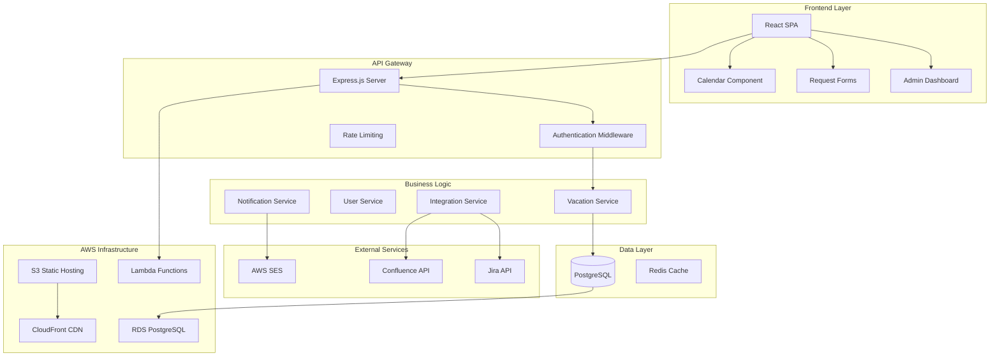
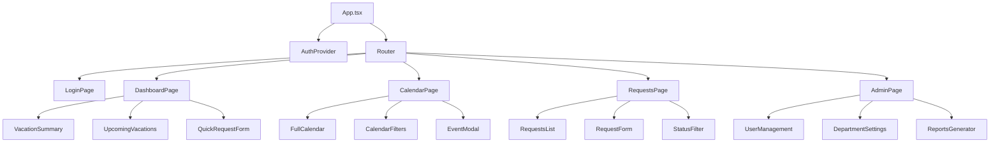
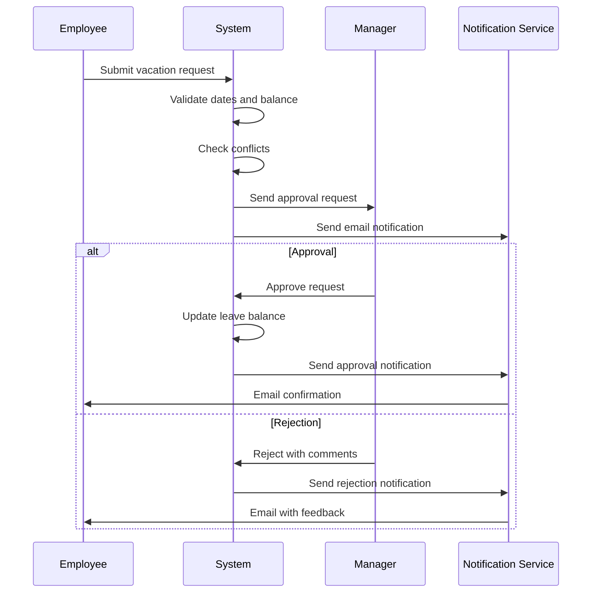
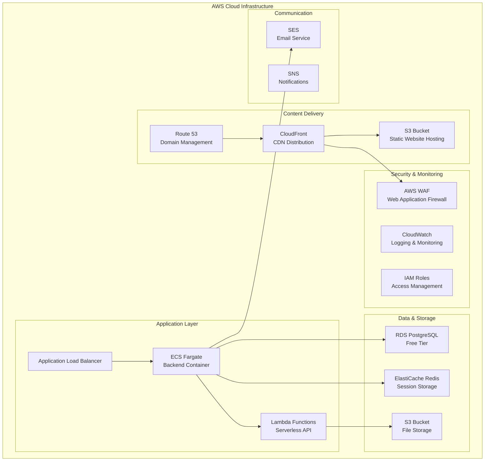

# Team Vacation Calendar - Full-Stack Application Design

## Overview

A comprehensive team vacation calendar system designed as a standalone web application with optional Confluence/Jira integration capabilities. The system provides complete leave management functionality with a modern, responsive interface and supports team collaboration for vacation planning.

### Key Features
- Employee vacation request submission and approval workflow
- Interactive calendar visualization with drag-and-drop functionality
- Team availability overview and conflict detection
- Email notifications for requests and approvals
- Department-wise filtering and reporting
- Optional Confluence/Jira integration via REST APIs
- Mobile-responsive design
- Role-based access control (Employee, Manager, HR Admin)

### Technology Stack
- **Frontend**: React 18 + TypeScript + Vite
- **Backend**: Node.js + Express + TypeScript
- **Database**: PostgreSQL (AWS RDS Free Tier)
- **Authentication**: JWT with bcrypt
- **Calendar Library**: FullCalendar.js (Open Source)
- **UI Components**: Material-UI (Free)
- **Email Service**: AWS SES (Free Tier)
- **File Storage**: AWS S3 (Free Tier)
- **Deployment**: AWS CloudFormation + S3 + CloudFront + Lambda

## Architecture



## Data Models & Database Schema

### Users Table
| Field | Type | Description |
|-------|------|-------------|
| id | UUID | Primary key |
| email | VARCHAR(255) | Unique email address |
| password_hash | VARCHAR(255) | Bcrypt hashed password |
| first_name | VARCHAR(100) | Employee first name |
| last_name | VARCHAR(100) | Employee last name |
| department | VARCHAR(100) | Department name |
| role | ENUM | Employee, Manager, HR_Admin |
| manager_id | UUID | Foreign key to manager |
| annual_leave_days | INTEGER | Total annual leave entitlement |
| remaining_leave_days | INTEGER | Remaining leave days |
| created_at | TIMESTAMP | Record creation time |
| updated_at | TIMESTAMP | Last update time |

### Vacation Requests Table
| Field | Type | Description |
|-------|------|-------------|
| id | UUID | Primary key |
| user_id | UUID | Foreign key to users |
| start_date | DATE | Vacation start date |
| end_date | DATE | Vacation end date |
| days_requested | INTEGER | Number of working days |
| type | ENUM | Annual_Leave, Sick_Leave, Personal |
| status | ENUM | Pending, Approved, Rejected |
| reason | TEXT | Optional reason for leave |
| manager_comments | TEXT | Manager approval/rejection notes |
| approved_by | UUID | Foreign key to approving manager |
| approved_at | TIMESTAMP | Approval timestamp |
| created_at | TIMESTAMP | Request creation time |
| updated_at | TIMESTAMP | Last update time |

### Departments Table
| Field | Type | Description |
|-------|------|-------------|
| id | UUID | Primary key |
| name | VARCHAR(100) | Department name |
| manager_id | UUID | Department manager |
| max_concurrent_leave | INTEGER | Max people on leave simultaneously |

## API Endpoints Reference

### Authentication Endpoints
- `POST /api/auth/login` - User authentication
- `POST /api/auth/logout` - User logout
- `POST /api/auth/refresh` - Refresh JWT token
- `GET /api/auth/me` - Get current user profile

### Vacation Request Endpoints
- `GET /api/vacations` - List vacation requests (with filters)
- `POST /api/vacations` - Create new vacation request
- `GET /api/vacations/:id` - Get specific vacation request
- `PUT /api/vacations/:id` - Update vacation request
- `DELETE /api/vacations/:id` - Cancel vacation request
- `POST /api/vacations/:id/approve` - Approve vacation request
- `POST /api/vacations/:id/reject` - Reject vacation request

### Calendar Endpoints
- `GET /api/calendar/events` - Get calendar events for date range
- `GET /api/calendar/team/:departmentId` - Get team calendar
- `GET /api/calendar/conflicts` - Check for scheduling conflicts

### User Management Endpoints
- `GET /api/users` - List users (admin only)
- `POST /api/users` - Create new user (admin only)
- `PUT /api/users/:id` - Update user profile
- `GET /api/users/me/balance` - Get leave balance

### Integration Endpoints
- `POST /api/integrations/confluence/sync` - Sync with Confluence
- `POST /api/integrations/jira/webhook` - Jira webhook handler
- `GET /api/integrations/status` - Integration health check

## Component Architecture

### Core Frontend Components



### Component Hierarchy
- **App Component**: Root component with routing and global state
- **AuthProvider**: Authentication context and JWT management
- **Calendar Components**:
  - FullCalendar wrapper with custom event rendering
  - Event creation/editing modals
  - Drag-and-drop vacation scheduling
- **Request Management**:
  - Vacation request forms with validation
  - Approval workflow components
  - Status tracking and history
- **Admin Dashboard**:
  - User management interface
  - Department configuration
  - Analytics and reporting

## Business Logic Layer

### Vacation Request Workflow



### Leave Balance Calculation
- Automatic calculation of working days excluding weekends and holidays
- Prorated leave allocation for new employees
- Carry-over rules for unused vacation days
- Real-time balance updates after approvals

### Conflict Detection Algorithm
- Check for overlapping vacation requests in same department
- Validate against maximum concurrent leave limits
- Holiday and blackout period restrictions
- Manager availability requirements

## Integration Strategy

### Confluence Integration
- **Authentication**: OAuth 2.0 or API tokens
- **Page Creation**: Automatic vacation calendar page generation
- **Synchronization**: Weekly sync of approved vacations
- **Template**: Custom Confluence macro for calendar display

### Jira Integration
- **Project Integration**: Link vacation requests to project timelines
- **Webhook Support**: Real-time updates when project deadlines change
- **Resource Planning**: Automatic adjustment of sprint capacity
- **Reporting**: Vacation impact on project velocity

## AWS Deployment Architecture



### Deployment Components

#### Frontend Deployment (S3 + CloudFront)
- **S3 Static Website**: React build artifacts hosted on S3
- **CloudFront CDN**: Global content delivery with edge caching
- **Route 53**: Custom domain with SSL certificate
- **Cost Estimate**: $1-5/month for typical usage

#### Backend Deployment Options

**Option 1: ECS Fargate (Recommended)**
- Containerized Node.js application
- Auto-scaling based on CPU/memory usage
- Load balancer for high availability
- Cost: $10-20/month

**Option 2: Lambda + API Gateway**
- Serverless functions for API endpoints
- Pay-per-request pricing model
- Automatic scaling to zero
- Cost: $0-10/month for low-medium traffic

#### Database & Storage
- **RDS PostgreSQL**: Free tier (750 hours/month)
- **ElastiCache**: Session storage and caching
- **S3**: File storage for attachments and backups

### One-Click Deployment Strategy

#### CloudFormation Template Structure
```yaml
# Infrastructure as Code template includes:
# - VPC and networking configuration
# - RDS database setup with initial schema
# - ECS cluster and service definitions
# - Load balancer and security groups
# - S3 buckets for static hosting and storage
# - IAM roles and policies
# - CloudFront distribution
# - Route 53 hosted zone (optional)
```

#### Deployment Scripts
- **setup.sh**: Master deployment script
- **deploy-infrastructure.sh**: AWS CloudFormation stack creation
- **deploy-backend.sh**: Container build and ECS deployment
- **deploy-frontend.sh**: React build and S3 upload
- **configure-domain.sh**: DNS and SSL certificate setup

#### Environment Configuration
- Automated environment variable injection
- Database migration scripts
- Initial admin user creation
- Sample data population
- Health check validation

## Security Implementation

### Authentication & Authorization
- **JWT Tokens**: Secure token-based authentication
- **Role-Based Access**: Employee, Manager, HR Admin roles
- **Password Security**: Bcrypt hashing with salt rounds
- **Session Management**: Secure session handling with Redis

### Data Protection
- **HTTPS Enforced**: SSL/TLS encryption for all communications
- **Database Encryption**: RDS encryption at rest
- **Input Validation**: Comprehensive request validation
- **SQL Injection Prevention**: Parameterized queries

### AWS Security Best Practices
- **IAM Roles**: Principle of least privilege
- **VPC Security**: Private subnets for database
- **Security Groups**: Restrictive firewall rules
- **WAF Protection**: SQL injection and XSS prevention

## Testing Strategy

### Unit Testing
- **Frontend**: Jest + React Testing Library
- **Backend**: Jest + Supertest for API testing
- **Database**: Test database with migration scripts
- **Coverage Target**: 80% code coverage minimum

### Integration Testing
- **API Integration**: End-to-end API workflow testing
- **Database Integration**: Repository pattern testing
- **External Services**: Mock Confluence/Jira APIs
- **Authentication Flow**: JWT token lifecycle testing

### End-to-End Testing
- **Cypress**: User journey automation
- **Critical Paths**: Login, request submission, approval workflow
- **Cross-Browser**: Chrome, Firefox, Safari compatibility
- **Mobile Responsive**: Touch interface testing

## Monitoring & Maintenance

### Application Monitoring
- **CloudWatch Metrics**: Custom application metrics
- **Error Tracking**: Centralized error logging
- **Performance Monitoring**: Response time and throughput
- **Uptime Monitoring**: Health check endpoints

### Cost Optimization
- **S3 Lifecycle Policies**: Automatic file archiving
- **CloudFront Caching**: Reduced origin requests
- **RDS Optimization**: Connection pooling and query optimization
- **Lambda Cold Start**: Warmer functions for critical paths

### Backup & Recovery
- **Database Backups**: Automated daily RDS snapshots
- **Code Repository**: Git-based version control
- **Configuration Backup**: CloudFormation templates
- **Disaster Recovery**: Multi-AZ deployment option